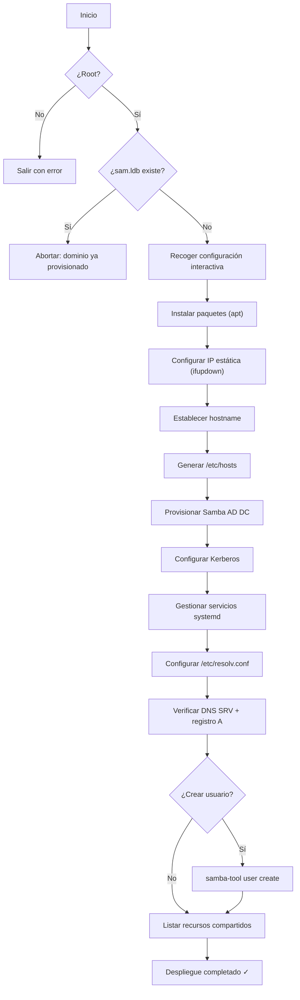

# AutoInstallDomain.sh

**Automatización del despliegue de un Controlador de Dominio Samba Active Directory en Debian/Linux.**

> Provisiona un Samba AD DC funcional en una única ejecución interactiva: configura red estática, hostname, DNS, Kerberos y servicios, aplicando validaciones y copias de seguridad en cada paso.

---

## Índice

- [Descripción general](#descripción-general)
- [Requisitos previos](#requisitos-previos)
- [Arquitectura del script](#arquitectura-del-script)
- [Instalación y ejecución](#instalación-y-ejecución)
- [Parámetros solicitados](#parámetros-solicitados)
- [Flujo de ejecución](#flujo-de-ejecución)
- [Ficheros modificados](#ficheros-modificados)
- [Verificaciones post-instalación](#verificaciones-post-instalación)
- [Solución de problemas](#solución-de-problemas)
- [Consideraciones de seguridad](#consideraciones-de-seguridad)
- [Limitaciones](#limitaciones)
- [Licencia](#licencia)

---

## Descripción general

`AutoInstallDomain.sh` automatiza el proceso completo de provisión de un **Samba Active Directory Domain Controller (AD DC)** sobre sistemas basados en **Debian** con `systemd` e `ifupdown`. El script guía al administrador a través de una serie de pasos interactivos, validando cada entrada y generando copias de seguridad antes de modificar cualquier fichero del sistema.

### ¿Qué hace?

| Fase | Acción |
|------|--------|
| **Recogida de datos** | Solicita dominio, hostname, IP estática, máscara, gateway, DNS reenviador |
| **Paquetes** | Instala `samba`, `krb5-user`, `winbind`, `smbclient`, `dnsutils`, `iproute2` |
| **Red** | Configura IP estática en `/etc/network/interfaces` mediante `ifupdown` |
| **Hostname** | Aplica el nuevo hostname con `hostnamectl` |
| **Hosts** | Genera `/etc/hosts` con la resolución FQDN del controlador |
| **Samba AD DC** | Ejecuta `samba-tool domain provision` con DNS interno y RFC 2307 |
| **Kerberos** | Copia el `krb5.conf` generado por Samba a `/etc/krb5.conf` |
| **Servicios** | Desactiva `smbd`/`nmbd`/`winbind`/`systemd-resolved`, activa `samba-ad-dc` |
| **DNS local** | Configura `/etc/resolv.conf` para apuntar a `127.0.0.1` |
| **Validación** | Comprueba registros SRV (LDAP/Kerberos), registro A, `testparm` y nivel del dominio |

---

## Requisitos previos

### Sistema operativo

- **Debian 11 (Bullseye)** o superior (o derivados compatibles como Ubuntu Server sin NetworkManager activo).
- Sistema de inicio: **systemd**.
- Gestor de red: **ifupdown** (`ifup`/`ifquery` disponibles).

### Hardware / VM

| Recurso | Mínimo recomendado |
|---------|-------------------|
| CPU | 1 vCPU |
| RAM | 1 GB (2 GB recomendado) |
| Disco | 10 GB libres |
| Red | 1 interfaz con conectividad LAN |

### Requisitos de software

- Acceso a repositorios APT (conexión a Internet o mirror local).
- `bash` ≥ 4.4 (por `${var,,}` y `set -Eeuo pipefail`).
- **No** debe haber un dominio Samba ya provisionado (`/var/lib/samba/private/sam.ldb` no debe existir).

### Incompatibilidades

> [!WARNING]
> El script **no es compatible** con los siguientes gestores de red activos:
> - `NetworkManager`
> - `systemd-networkd`
>
> Desactívalos antes de ejecutar el script si tu sistema los utiliza.

---

## Arquitectura del script

```
AutoInstallDomain.sh
│
├── Funciones auxiliares
│   ├── is_root()           → Verifica privilegios de root
│   ├── valid_ipv4()        → Valida formato IPv4
│   ├── valid_netmask()     → Valida máscara de red contigua
│   ├── ask_required()      → Solicita entrada obligatoria
│   └── backup_file()       → Crea copia de seguridad con timestamp
│
├── Flujo principal (main)
│   ├── initial_config()    → Recoge y valida datos del dominio
│   ├── pkg()               → Instala paquetes necesarios
│   ├── config_network()    → Configura IP estática (ifupdown)
│   ├── config_hostname()   → Establece hostname
│   ├── hosts()             → Genera /etc/hosts
│   ├── samba()             → Provisiona Samba AD DC
│   ├── krb5()              → Configura Kerberos
│   ├── services()          → Gestiona servicios systemd
│   ├── resolv()            → Configura /etc/resolv.conf
│   └── level_domain()      → Verificaciones finales + usuario opcional
```

---

## Instalación y ejecución

### 1. Clonar o copiar el script

```bash
git clone https://github.com/DcastrGD/Domain-Linux.git /opt/Domain-Linux
cd /opt/Domain-Linux
```

### 2. Dar permisos de ejecución

```bash
chmod +x AutoInstallDomain.sh
```

### 3. Ejecutar como root

```bash
sudo bash AutoInstallDomain.sh
```

> [!CAUTION]
> **No ejecutar sobre un servidor que ya tiene un dominio provisionado.** El script comprueba la existencia de `/var/lib/samba/private/sam.ldb` y abortará si lo encuentra, pero la precaución adicional es recomendable.

> [!IMPORTANT]
> Si estás conectado por **SSH** a través de la misma interfaz que se va a reconfigurar, **perderás la conexión** al aplicar la nueva IP estática. Usa una consola local o un acceso por KVM/IPMI.

---

## Parámetros solicitados

El script es **completamente interactivo** y no acepta argumentos por línea de comandos. Durante la ejecución solicita:

| Parámetro | Ejemplo | Validación |
|-----------|---------|------------|
| Nombre del dominio | `acme` | 1-15 caracteres alfanuméricos/guiones (NetBIOS) |
| Extensión del dominio | `local` | Formato DNS válido |
| Cambio de hostname | `dc01` | Formato hostname válido (opcional) |
| Interfaz de red | `enp0s3` | Se verifica que existe con `ip link` |
| Dirección IPv4 | `192.168.1.10` | IPv4 válida (4 octetos, 0-255) |
| Máscara de red | `255.255.255.0` | Máscara contigua válida |
| Puerta de enlace | `192.168.1.1` | IPv4 válida (opcional) |
| DNS reenviador | `8.8.8.8` | IPv4 válida |
| Contraseña de Administrator | `********` | Mínimo 8 caracteres, doble confirmación |

---

## Flujo de ejecución



---

## Ficheros modificados

Todos los ficheros existentes se respaldan automáticamente antes de ser modificados (extensión `.bak` o `.bak.YYYYMMDD-HHMMSS` si ya existe un backup previo).

| Fichero | Acción | Backup |
|---------|--------|--------|
| `/etc/network/interfaces` | Reescrito con IP estática | ✅ |
| `/etc/hosts` | Reescrito con FQDN del DC | ✅ |
| `/etc/hostname` | Modificado vía `hostnamectl` | — |
| `/etc/samba/smb.conf` | Reescrito por `samba-tool` | ✅ (→ `.pre-provision`) |
| `/etc/krb5.conf` | Sobrescrito con versión de Samba | ✅ |
| `/etc/resolv.conf` | Reescrito (symlink eliminado si existe) | ✅ |

---

## Verificaciones post-instalación

Tras la ejecución del script, se ejecutan automáticamente las siguientes comprobaciones:

### DNS

```bash
# Registro SRV LDAP
host -t SRV _ldap._tcp.acme.local 127.0.0.1

# Registro SRV Kerberos
host -t SRV _kerberos._udp.acme.local 127.0.0.1

# Registro A del controlador
host -t A dc01.acme.local 127.0.0.1
```

### Samba

```bash
# Nivel funcional del dominio
samba-tool domain level show

# Verificar configuración
testparm -s

# Listar recursos compartidos
smbclient -L localhost -U Administrator
```

### Kerberos

```bash
# Obtener ticket (verificación manual recomendada)
kinit administrator@ACME.LOCAL
klist
```

### Servicios

```bash
systemctl status samba-ad-dc.service
```

---

## Solución de problemas

| Síntoma | Causa probable | Solución |
|---------|---------------|----------|
| `ifupdown no pudo activar la interfaz` | Conflicto con otro gestor de red | Desactivar NetworkManager / systemd-networkd |
| `samba-ad-dc no está activo` | Puerto 53 o 389 ocupado | `ss -tlnp \| grep -E ':53\|:389'`, detener servicio conflictivo |
| `No se encuentra krb5.conf de Samba` | Provisión fallida | Revisar logs: `journalctl -u samba-ad-dc -b` |
| `Contraseña rechazada` | Política de complejidad de AD | Usar mayúsculas, minúsculas, números y símbolos (≥ 8 caracteres) |
| `Error en la línea X` | `set -Eeuo pipefail` activado | El trap indica la línea exacta; revisar paso a paso |

### Logs útiles

```bash
# Logs de Samba
journalctl -u samba-ad-dc -b --no-pager

# Logs de red
journalctl -u networking -b --no-pager

# Logs del sistema
journalctl -b --no-pager | tail -100
```

---

## Consideraciones de seguridad

> [!IMPORTANT]
> - La contraseña de `Administrator` se solicita de forma segura (sin eco en pantalla) y se elimina de las variables del entorno (`unset`) inmediatamente después de la provisión.
> - El script **no almacena credenciales** en disco ni en logs.
> - Se recomienda ejecutar desde una **consola local** o sesión segura, no a través de conexiones no cifradas.

- Los ficheros generados (`/etc/network/interfaces`, `/etc/hosts`, etc.) se instalan con permisos `0644`.
- `set -Eeuo pipefail` garantiza que cualquier error no controlado detenga la ejecución inmediatamente, evitando estados parciales silenciosos.
- El script incluye un trap `ERR` que reporta la línea exacta del fallo.

---

## Limitaciones

- **Solo provisionamiento inicial.** No soporta unir réplicas ni dominios secundarios.
- **Solo ifupdown.** No es compatible con `NetworkManager` ni `systemd-networkd` para la configuración de red.
- **Solo IPv4.** No configura direccionamiento IPv6 para el dominio.
- **DNS backend interno.** Utiliza `SAMBA_INTERNAL`; no soporta BIND9 como backend DNS.
- **Ejecución única.** No es idempotente: aborta si detecta un dominio ya provisionado.

---

## Licencia

Este proyecto se distribuye bajo la **GNU General Public License v3.0 (GPLv3)**, compatible con la licencia de Samba.

Consulta el fichero [`LICENSE`](LICENSE) para el texto completo.

---

<p align="center">
  <em>Generado para administradores de sistemas · Probado sobre Debian 12 Bookworm</em>
</p>
